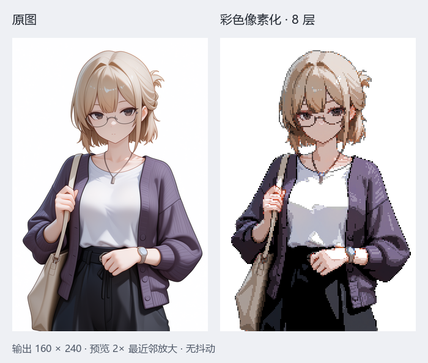
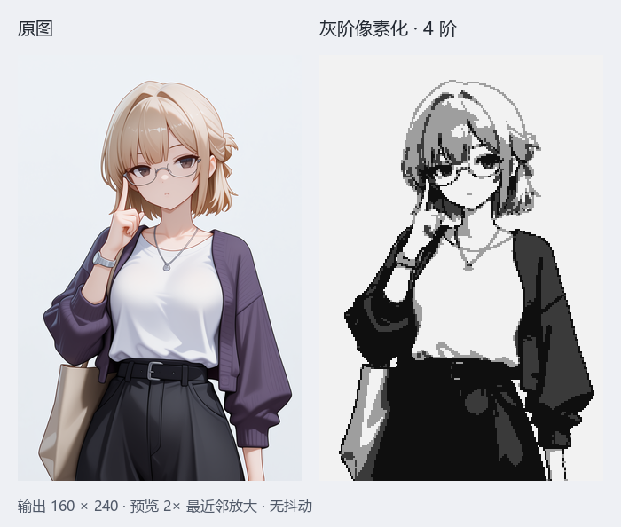
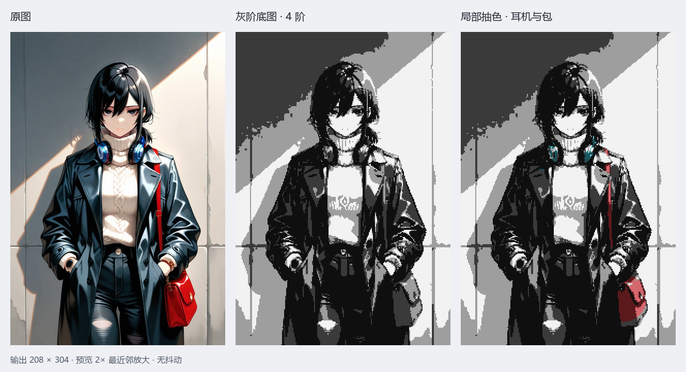

# pixcelOE

**简体中文** | [English](README.en.md)

**将照片和插画转换为像素风图像，支持明暗分层、轮廓保留和局部抽色。**

当前版本：**1.5.0-alpha.1** · Alpha 测试阶段

pixcelOE 提供单文件 HTML 和 Python 本地服务两种运行方式。通过可视化参数调整像素块、灰阶、色彩层数与调色板，也可以让画面主体保持灰阶，仅为领带、耳机、徽章等区域保留或指定色相。

[效果示例](#效果示例) · [快速开始](#快速开始) · [抽色艺术](#抽色艺术) · [开发与测试](#开发与测试) · [更新记录](CHANGELOG.md)

## 功能

- **像素化处理**：明暗分层、轮廓扩展、五种像素块取值方式及调色板量化。
- **彩色与灰阶模式**：彩色模式按原图对应位置保留色相，以层数调整明暗；灰阶模式提供角色和场景调色板。
- **局部抽色**：原图颜色筛选与矩形、画笔遮罩共同限定区域，着色时保留灰阶成品的明度。
- **杂色清理**：可调边缘清理、近灰色保护、抽色最小连通色块过滤与黑线保护。
- **交互预览**：成品、原图、并排视图，缩放、平移、像素网格及参数撤销/重做。
- **预设与导出**：自定义预设、批量处理、整数倍 PNG 导出及同名 JSON 元数据。
- **本机处理**：HTML 版在浏览器内计算，Python 版默认仅监听本机地址；图片处理无需云端服务。

## 效果示例

以下示例由 `1.5.0-alpha.1` 实际处理，逐张调整参数，均关闭抖动。原图缩放展示，成品使用 2 倍最近邻放大；Python 与独立 HTML 的输出已逐像素核对一致。

### 彩色像素化

保留原图对应位置的色相，以 **8 层明度**表现头发、衣物和皮肤的色块。原图 `640×960`，输出 `160×240`；亮度 −5、对比度 10、标准边缘杂色清理。[完整参数](docs/examples/color-params.json)



### 灰阶像素化

以 **4 阶灰度**概括明暗，保留眼镜、轮廓及衣物折线。原图 `640×960`，输出 `160×240`；亮度 0、对比度 25。[完整参数](docs/examples/gray-params.json)



### 局部抽色

从灰阶底图出发，按原图颜色和区域筛选耳机、肩带与包，并用画笔遮罩排除手腕附近的误选。着色保留对应灰阶明度，青色耳机与红色包仍有明暗分层。原图 `832×1216`，输出 `208×304`；4 阶灰度、亮度 25、对比度 0。[完整参数与遮罩](docs/examples/selective-params.json)



## 快速开始

### 单文件 HTML 版

1. 下载仓库中的 [pixcelOE.html](pixcelOE.html)。
2. 使用桌面版 Edge 或 Chrome 打开文件。
3. 拖入图片或点击「选择图片」，调整参数，点击「导出 PNG」。

无需安装 Python、启动服务或构建项目。图片通过 Web Worker 后台处理。PNG 与 JSON 保存到浏览器下载位置；批量导出时，浏览器可能要求允许多个文件下载。

### Python 本地服务版

需要 Python 3.9+、NumPy 和 Pillow。下载并解压完整仓库，在项目目录执行：

```bash
python -m pip install numpy pillow
python app.py
```

浏览器会自动打开 `http://127.0.0.1:8760`。Windows 用户也可双击 [启动.bat](启动.bat)，由脚本检查并安装缺少的依赖。

```bash
python app.py --port 9000   # 指定起始端口，被占用时向后寻找
python app.py --no-browser  # 启动服务，不自动打开浏览器
python app.py --version    # 查看版本
```

服务版导出至项目的 `outputs/` 目录。`web/index.html` 是服务版页面，请通过服务访问。

| 项目 | 单文件 HTML 版 | Python 本地服务版 |
|---|---|---|
| 入口 | `pixcelOE.html` | `python app.py` / `启动.bat` |
| 图像计算 | 浏览器 Web Worker | NumPy + Pillow |
| 安装要求 | 桌面浏览器 | Python 及两项依赖 |
| 导出位置 | 浏览器下载目录 | 项目 `outputs/` 目录 |
| 图像处理是否需要网络 | 否 | 否；首次安装依赖需要网络或离线包 |

## 基本操作

1. 导入 PNG、JPEG 或 WebP 等图片。服务版单张上限为 64 MB、4000 万像素；HTML 版格式支持取决于浏览器，像素上限同为 4000 万。
2. 选择角色或场景预设，再调整亮度、对比度、分层和轮廓参数。
3. 调整「缩小倍数」控制像素块大小。例如 `640×960` 使用 4 倍缩小后得到 `160×240`。
4. 用原图或并排视图检查对应位置，用像素网格检查细节。
5. 导出 PNG 与 JSON，后者记录版本、处理参数、缩放倍数及检查结果。

尺寸无需整除缩小倍数：最后一个像素块采用边缘复制补齐，输出尺寸向上取整。导出支持 1–8 的整数倍放大。

自定义预设保存在当前浏览器的本地存储中。清除浏览器数据、切换浏览器或文件位置后，预设可能无法沿用；重要参数可通过导出 JSON 留存。

### 参数速查

| 参数 | 用途 |
|---|---|
| 亮度 / 对比度 | 调整整体明暗与明暗差异 |
| 灰阶层数 | 控制灰阶明度分层 |
| 保留彩色 / 色彩层数 | 保留原图色相，并调整彩色明度层数 |
| 细节敏感度 / 线条粗细 | 调整轮廓统计范围与形态学处理强度 |
| 保留细线 | 尽量保留睫毛、衣物缝线等小细节 |
| 缩小倍数 | 控制输出分辨率和像素块大小 |
| 像素块取值方式 | `bridge` 补断线、`skew` 偏斜取值、`dark` 暗线保护、`edge` 亮底边缘保护、`median` 中值取样 |
| 暗线保留强度 | 控制像素块内暗线的判定阈值 |
| 调色板 / 颜色数 | 控制灰阶用色；颜色数为 0 时使用完整调色板 |
| 抖动 | 可选 Bayer 4×4 / 8×8 明度抖动，默认关闭 |
| 边缘杂色清理 | 关闭、轻度或标准；标准模式可能移除极小异色色点 |
| 目标画布 | 检查输出尺寸，留空则不检查 |

Gamma 已从当前界面和处理流程移除，旧预设中的 Gamma 字段会被忽略。

## 抽色艺术

抽色将灰阶成品中的指定区域着色。**输出采用所选颜色的色相与饱和度，HSL 明度沿用灰阶成品对应像素**，因此能够保留亮部、阴影与明暗分层。颜色选择器中的明度不覆盖灰阶明度。

1. 勾选「⑥ 抽色艺术」，添加抽色规则。
2. 点击「从原图取色」，选择需要筛选的颜色；取色成功后自动返回成品视图。
3. 设置「输出色相」，调整色相容差与最低饱和度。
4. 按需框选矩形，或使用「画笔绘制遮罩」涂抹允许抽色的区域。颜色筛选、矩形与画笔遮罩取交集。
5. 使用橡皮擦、撤销一笔或清除遮罩修正范围，点击「完成遮罩」查看成品。
6. 调整黑线保护和「最小连通色块」，减少暗线染色及零散彩点。

最小连通色块按**最终可见彩色像素**的四邻域连通面积计算，小于阈值的区域会被移除；不同明度的相连像素属于同一块。滑块最高 4096，也可输入更大数值。极小装饰需要保留时可设为 1。

最多支持 12 条规则，重叠位置以后面的规则为准。矩形和画笔使用原图比例坐标，改变缩小倍数后仍指向对应区域。规则可保存到预设和导出 JSON 中；批处理不同构图时，应重新检查区域位置。

未涂抹的区域保持灰阶；「清除遮罩」会解除画笔限制，恢复颜色筛选与矩形范围。按 Escape 可退出取色、框选或遮罩编辑。

## 检查与已知限制

导出报告包含目标尺寸、半透明像素、调色板用色和杂色检查，以及实际色值和抽色面积。检查口径以项目内置灰阶和抽色规则为依据；保留全彩或关闭量化时，调色板相关项可能不通过，仍可导出。

- 当前为 Alpha 版本，参数、界面和导出格式仍可能调整。
- 当前处理输出为不透明 RGB，不提供自动抠图或透明背景保留。
- 抽色依据原图颜色和空间范围，不识别物体；同一范围内的同色物体可能一起被选中。白、灰、黑缺少可筛选的色相。
- 近灰色像素保持中性，以减少调暗近白背景时产生的饱和噪点；标准杂色清理可能牺牲 1–2 像素的瞳孔或装饰。
- 大图、复杂轮廓和大量画笔笔画会增加计算时间，性能取决于设备与参数。
- 自动检查用于发现尺寸和用色问题，不能替代对轮廓、构图和艺术效果的人工判断。

## 开发与测试

服务使用 Python 标准库 `http.server`，图像计算使用 NumPy 和 Pillow；前端使用原生 HTML、CSS、JavaScript，无前端构建步骤。

```text
pixcelOE-TOOL/
├── VERSION                     当前版本号
├── pixcelOE.html                单文件 HTML 入口
├── app.py                      Python 服务启动入口
├── core/                       图像算法、处理流程、抽色与检查
├── server/api.py               HTTP 接口与静态资源服务
├── web/                        服务版界面及共享抽色脚本
├── data/palette.json           内置调色板
├── tests/                      算法、接口与浏览器测试
├── docs/                       修复记录及历史路线图
└── 启动.bat                    Windows 启动脚本
```

以下算法和静态资源检查使用仓库内构造的测试数据；两端一致性测试还需要 Node.js：

```bash
python tests/test_color_hue.py
python tests/test_color_cleanup.py
python tests/test_color_regressions.py
python tests/test_selective.py
python tests/test_web_assets.py
python tests/test_standalone.py
node tests/test_web_render.mjs
```

`node tests/test_standalone_browser.mjs` 使用真实 Edge / Chrome 验证离线导入、参数操作、画笔和导出。目前浏览器查找路径按 Windows 配置，需要本机安装相应浏览器。

`tests/test_consistency.py` 和 `tests/test_api.py` 使用作者本地的 `../mengshi-art-workflow/` 产线脚本或样例素材，未随本仓库分发。运行前需准备或替换测试中的相关路径；缺少这些数据时不能视为已完成端到端验证。服务版浏览器测试见 `tests/test_browser.py`。

Python 与独立 HTML 的算法对比覆盖灰阶、彩色、抽色、抖动、步骤开关、画笔遮罩与边界参数。共享的 `web/selective-algorithm.js` 和 `web/selective-controls.js` 同时嵌入独立 HTML，修改后需同步；一致性测试会检查副本。

详细验证记录见 [HTML 移植修复记录](docs/HTML_BUGFIX.md)。

## 反馈问题

提交 Issue 时，请说明版本、运行方式、操作系统、浏览器、复现步骤、处理参数，以及实际结果与预期结果。可附可公开的原图、成品和导出 JSON；提交前请确认素材适合公开。

## 许可

仓库目前未声明开源许可证。公开源码不代表已授予再分发或商业使用许可；具体使用权限请联系项目维护者。
